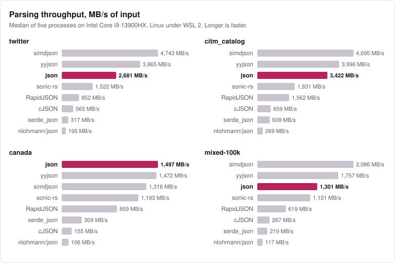
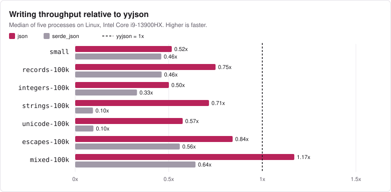

# json

The official JSON library for [Nia](https://github.com/nialang/nia). It parses
UTF-8 JSON text strictly, as RFC 8259 defines it, into a compact document that
you read through lightweight views, and writes values back as compact or
indented text.

```nia
using std::mem;
using std::option;
using json;

fun port(allocator: &mut mem::Allocator, text: &[u8]) ?u64 {
    let mut document = json::Document::init();
    defer _ = document.deinit(allocator);
    if document.parse(allocator, text) is error! {
        return null;
    }
    let config = document.value().?.asObject().?;
    let number = config.get(b"port").?.asNumber().?;
    match number.toU64() {
        !value => ?value,
        _! => null,
    }
}
```

## Features

- **Strict parsing.** Only RFC 8259 JSON in well-formed UTF-8 is accepted: no
  comments, trailing commas, byte order mark, `NaN`, or unpaired surrogates.
  The parser passes every accepting and rejecting case of
  [JSONTestSuite](https://github.com/nst/JSONTestSuite).
- **Exact numbers.** A number keeps the text it was written with. Conversions
  to `u64` and `i64` say when a value does not fit rather than rounding it, and
  conversions to `f64` and `f32` are correctly rounded.
- **Bounded work.** Limits on input length, nesting depth, value count, string
  length, and number length bound the time and memory of a parse. Nesting
  never uses the native stack, for parsing, reading, or writing.
- **Explicit allocation.** Every allocation goes through the allocator you
  pass. A document reuses its storage across parses, and an allocation failure
  at any point leaves it consistent and still owning everything it allocated.
- **Precise errors.** A failed parse reports what was wrong and where, as a
  byte offset and as a line and column.
- **Reading and writing.** Values are read through views that copy nothing.
  Objects keep their members in input order, duplicates included. Values can
  be looked up by [RFC 6901](https://www.rfc-editor.org/rfc/rfc6901) JSON
  Pointer, and written to any `std::io::Writer` without allocating.
- **Speed.** Parsing reads plain text sixteen bytes at a time and decodes
  strings in place. See [Performance](#performance) for how it compares with
  yyjson and serde_json.

## Performance

The charts compare json with [yyjson](https://github.com/ibireme/yyjson), one
of the fastest C libraries with the same kind of document, and with
[serde_json](https://github.com/serde-rs/json), Rust's common JSON library.
Each bar is a throughput as a multiple of yyjson's on the same input; the
dashed line is yyjson.

<picture>
  <source media="(prefers-color-scheme: dark)" srcset="docs/images/parse-dark.svg">
  
</picture>

<picture>
  <source media="(prefers-color-scheme: dark)" srcset="docs/images/write-dark.svg">
  
</picture>

In MB/s of input, on a few of the corpora:

| Corpus | Contents | json | yyjson | serde_json |
| --- | --- | ---: | ---: | ---: |
| `records-100k` parse | an array of small objects | 1335 | 1871 | 170 |
| `records-pretty` parse | the same, indented | 2000 | 2879 | 307 |
| `integers-100k` parse | an array of integers | 1167 | 1514 | 424 |
| `strings-100k` parse | long ASCII strings | 7491 | 4393 | 4509 |
| `mixed-100k` parse | messages shaped like an API feed | 1265 | 1915 | 225 |
| `records-100k` write | compact text into memory | 1512 | 2016 | 931 |
| `mixed-100k` write | compact text into memory | 2184 | 1865 | 1199 |

On structured documents json parses at 55 to 95 percent of yyjson's speed and
leads it on long strings; both are three to ten times as fast as serde_json,
which builds a tree of separately allocated values. The numbers come from one
machine (Intel Core i9-13900HX, Linux under WSL 2) and say how the libraries
compare there, not how fast any of them is in general.
[docs/benchmarks.md](docs/benchmarks.md) has every corpus, the method, the
versions measured, and how to run the comparison yourself.

## Installation

json is a Nia package. Add it to a package as a Git dependency:

```sh
nia add json --git https://github.com/nialang/json
```

which records it in `nia.toml`:

```toml
[dependencies]
json = { git = "https://github.com/nialang/json" }
```

and import it with `using json;`.

json follows the Nia toolchain's 0.3 development line (protocol epoch 3) and
is built and tested with the current `main` of
[nialang/nia](https://github.com/nialang/nia).

## Documentation

- [Guide](docs/guide.md): parsing, reading values, numbers, JSON Pointer,
  writing, limits, errors, and how a document owns its storage.
- [Design](docs/design.md): the document layout, the parser, the writer, and
  why they are built the way they are.
- [Testing](docs/testing.md): the test suites, conformance and differential
  checks, and how to run them.
- [Benchmarks](docs/benchmarks.md): the method, the comparators, and current
  results.

[examples/config.nia](examples/config.nia) is a complete program that reads a
configuration; run it with `nia build run-config`.

## Status

Version 0.1.0 is unreleased. It provides the document model: parsing, reading,
and writing. Planned for later versions are typed decoding and encoding of Nia
types through traits, a streaming reader for input that does not fit in
memory, and a mutable document for building and editing values. The API may
change before 1.0.

## Development

```sh
nia build test -O2                # unit and robustness suites
python tools/vendor.py            # fetch JSONTestSuite and yyjson
nia build conformance -O2
python tools/check.py             # conformance against JSONTestSuite
```

[docs/testing.md](docs/testing.md) describes every check.

## License

Licensed under either of

- Apache License, Version 2.0 ([LICENSE-APACHE](LICENSE-APACHE))
- MIT license ([LICENSE-MIT](LICENSE-MIT))

at your option. Unless you explicitly state otherwise, any contribution you
submit for inclusion in this work, as defined in the Apache-2.0 license, is
dual licensed as above, without any additional terms or conditions.
